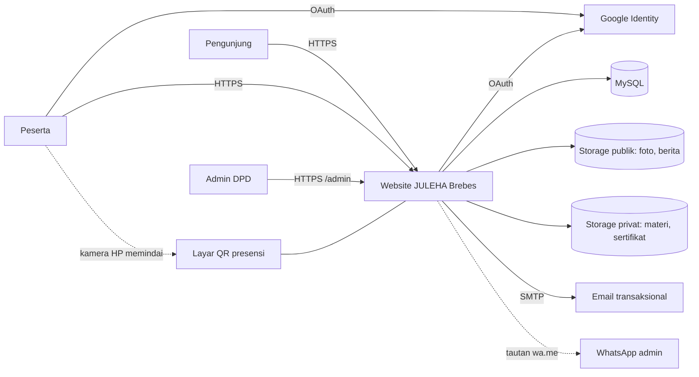
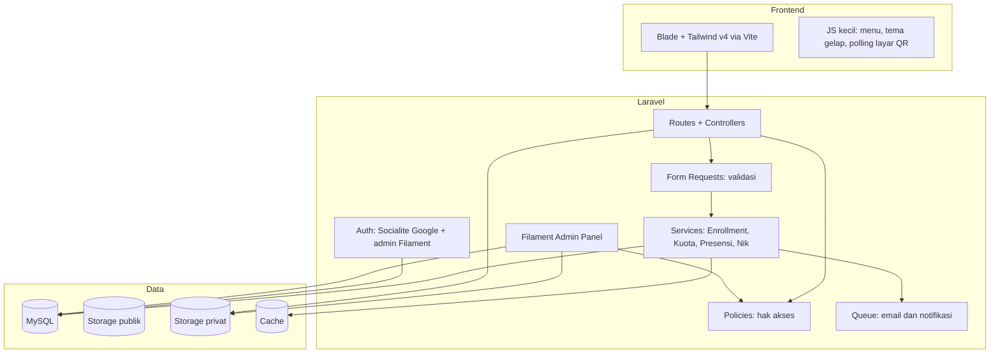
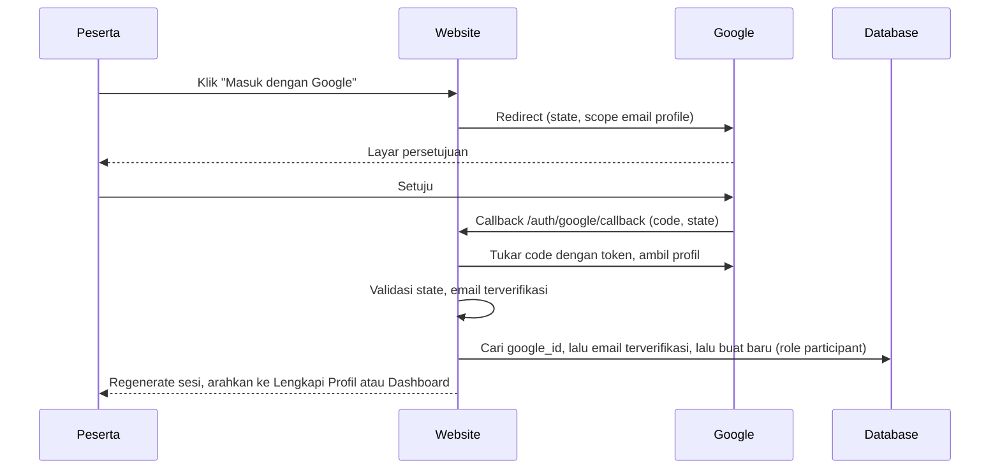
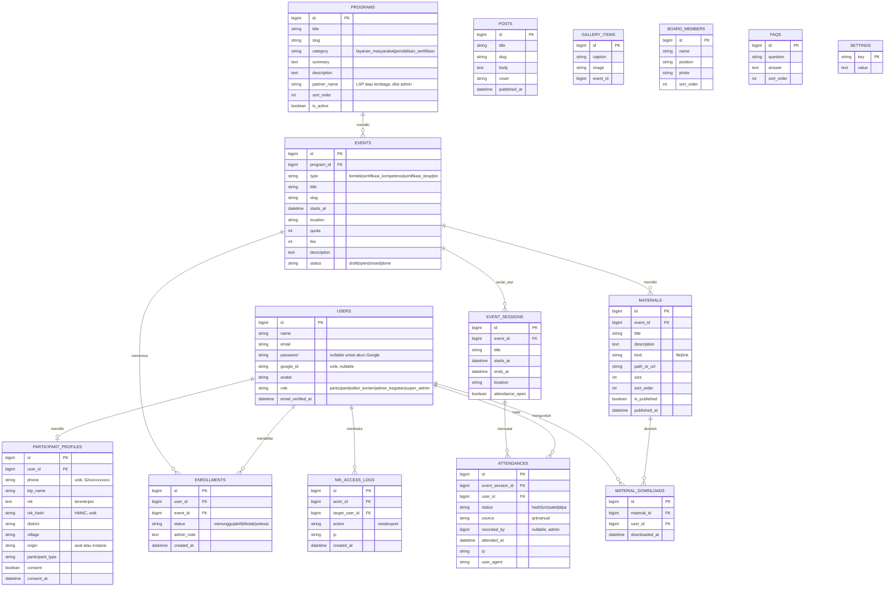
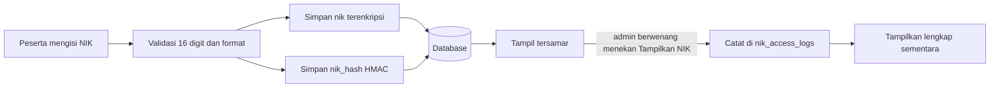
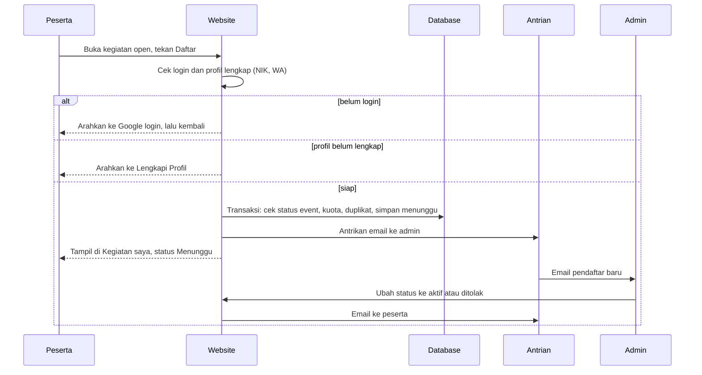
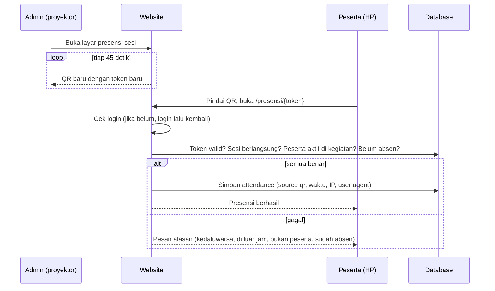

# Arsitektur Sistem: Website dan Portal Peserta DPD JULEHA Kabupaten Brebes

Versi 0.2 (13 Oktober 2026). Dokumen pendamping `prd.md`.

## Riwayat perubahan

| Versi | Perubahan |
|---|---|
| 0.1 | Rencana awal: company profile dan pendaftaran bimtek |
| 0.2 | Disesuaikan dengan kondisi aktual (Laravel, Filament, Vite). Menambah login Google, peran dan Policy, profil dengan NIK terenkripsi, enrollment, materi privat, presensi QR, audit, dan catatan deployment |

## 1. Kondisi aktual proyek

| Aspek | Nilai |
|---|---|
| Framework | Laravel 13.x (terlihat 13.35 pada halaman error) |
| PHP | 8.3.x |
| Database | MySQL/MariaDB (lokal lewat Laragon, database `juleha_brebes`) |
| Panel admin | Filament, di `/admin` |
| Tampilan | Template CardioCare dikonversi ke Blade + Vite + Tailwind v4, tema ungu tua dan emas |
| Lingkungan kerja | Windows + Laragon, dikerjakan dengan agent di Antigravity |
| Template asli | Disimpan sebagai referensi di luar `public/` (`cardiocare-template/`) dan masuk `.gitignore` |

Catatan: versi Laravel dan paket pihak ketiga (Filament, Socialite, paket ekspor Excel, pembuat QR) harus selalu dicek kompatibilitasnya sebelum dipasang.

## 2. Prinsip arsitektur

1. **Template hanya lapisan tampilan.** Aturan bisnis (kuota, hak akses, presensi) ada di backend.
2. **Satu sumber kebenaran untuk data organisasi:** tabel `settings`. Tidak ada kontak, alamat, atau nomor SK yang tertulis permanen di view.
3. **Hak akses lewat Policy**, bukan pengecekan peran di banyak tempat.
4. **Data sensitif (NIK) dienkripsi, disamarkan, dan diaudit.**
5. **File materi dan sertifikat privat**, diakses lewat route yang memeriksa izin.
6. **Cadangan manual untuk setiap fitur otomatis** (presensi manual, WhatsApp sebagai jalur cadangan).

## 3. Konteks sistem



## 4. Komponen



## 5. Autentikasi dan peran

### 5.1 Dua jalur login terpisah

| Pengguna | Jalur | Akses |
|---|---|---|
| Peserta | **Login dengan Google** (Laravel Socialite, scope `openid email profile`) | `/dashboard`, bukan `/admin` |
| Admin | Email + password Filament | `/admin` |
| Cadangan (opsional) | Daftar email + password untuk peserta, diaktifkan lewat toggle di pengaturan situs, default nonaktif | `/dashboard` |

### 5.2 Alur login Google



Aturan penting:
- Penautan akun berdasarkan email **hanya jika email terverifikasi oleh Google**.
- Akun dari Google selalu `participant`. Tidak ada jalur OAuth yang bisa menaikkan peran.
- `canAccessPanel` pada model `User` hanya mengizinkan `super_admin`, `admin_kegiatan`, dan `editor_konten`.
- Kredensial (`GOOGLE_CLIENT_ID`, `GOOGLE_CLIENT_SECRET`, `GOOGLE_REDIRECT_URI`) hanya di `.env`.

### 5.3 Matriks hak akses (Policy)

| Aksi | participant | editor_konten | admin_kegiatan | super_admin |
|---|:-:|:-:|:-:|:-:|
| Lihat dan edit profil sendiri | ✓ | ✓ | ✓ | ✓ |
| Mendaftar kegiatan | ✓ | - | - | - |
| Kelola berita, galeri, FAQ, program | - | ✓ | ✓ | ✓ |
| Lihat dan konfirmasi pendaftaran | - | - | ✓ | ✓ |
| Unggah dan ubah materi | - | - | ✓ | ✓ |
| Buka layar presensi, kelola sesi, presensi manual | - | - | ✓ | ✓ |
| Buka NIK lengkap (tercatat) | - | - | ✓ | ✓ |
| Ekspor dengan NIK | - | - | - | ✓ |
| Pengaturan situs, kelola pengguna | - | - | - | ✓ |
| Lihat materi kegiatan | hanya enrollment aktif | - | ✓ | ✓ |

Policy: `EnrollmentPolicy`, `MaterialPolicy`, `EventSessionPolicy`, `AttendancePolicy`. Peran `instruktur` belum ada, dan penambahannya nanti cukup memperluas Policy.

## 6. Model data



Tabel Fase 5 (belum final, menunggu jawaban pengurus): `competency_results` (enrollment_id, hasil, nomor sertifikat, penerbit, tanggal terbit, masa berlaku, file sertifikat privat).

### Aturan data penting

- `enrollments`: unique `(user_id, event_id)`. Pengecekan kuota dilakukan **di dalam transaksi database**.
- `attendances`: unique `(event_session_id, user_id)`.
- `participant_profiles.phone` dinormalisasi ke `62xxxxxxxxxx` dan unik. Format tampilan `0823-2444-8886`, sedangkan link `wa.me` memakai format `62...`.
- `participant_profiles.nik_hash` unik, dipakai untuk mencegah satu NIK dipakai banyak akun.
- Kode registrasi lama (`registrations`) tidak dihapus. Data ditautkan ke akun hanya bila nomor HP cocok, selebihnya dibiarkan sebagai arsip.
- Zona waktu aplikasi `Asia/Jakarta`, dan semua perbandingan waktu sesi memakai zona itu.

## 7. Penanganan NIK



| Kontrol | Implementasi |
|---|---|
| Enkripsi | Cast `encrypted` Laravel, kolom `TEXT` |
| Duplikat | `nik_hash` = HMAC-SHA256 dengan `NIK_HASH_KEY` (terpisah dari `APP_KEY`), unique index |
| Penyamaran | 4 digit awal dan 4 digit akhir di semua tampilan default |
| Pembukaan lengkap | Aksi khusus untuk `super_admin` dan `admin_kegiatan`, tercatat di `nik_access_logs` |
| Kebocoran lewat keluaran | `$hidden` pada model, tidak masuk log, exception report, email, notifikasi, URL, atau pesan WhatsApp |
| Ekspor | Default tanpa NIK. Ekspor dengan NIK hanya `super_admin`, dengan konfirmasi dan tercatat |
| Perubahan | Setelah dipakai pada sertifikat yang terbit, perubahan hanya lewat admin |
| Kunci | `APP_KEY` dan `NIK_HASH_KEY` disimpan di luar repo, **tidak diganti** setelah ada data |
| Backup | Terenkripsi dan disimpan terpisah dari server |
| Dukcapil | Tidak ada verifikasi. Hanya validasi format |

Dokumentasi operasional ditulis di `docs/data-pribadi.md` (data yang dikumpulkan, alasan, akses, rotasi kunci, backup, penghapusan, langkah saat insiden).

## 8. Alur pendaftaran kegiatan



## 9. Materi

- File disimpan di **disk privat** (`storage/app/private`), bukan `public/`. Nama file diacak.
- Unggah dibatasi tipe (pdf, ppt/pptx, doc/docx, xls/xlsx, mp4, gambar) dan ukuran. Video besar sebaiknya berupa tautan YouTube/Drive.
- Unduhan melalui route terkontrol `MaterialController@download`, dengan `MaterialPolicy`: peserta harus punya enrollment **aktif** pada kegiatan pemilik materi. Menebak ID atau URL kegiatan lain menghasilkan 403.
- Tautan video dibuka di tab baru. Tidak menanam iframe dari domain yang tidak dipercaya.
- Catatan unduhan disimpan di `material_downloads`.

## 10. Presensi QR

### 10.1 Rancangan anti titip absen

- Layar presensi ada di `/admin/presensi/{session}/layar`, hanya admin.
- QR berisi `https://domain/presensi/{token}`. Token acak, terikat ke satu sesi, **berganti tiap ±45 detik**, berlaku ±60 detik (toleransi jaringan), diverifikasi di server.
- QR dibuat di server atau dengan pustaka JS yang diberi versi tetap. **Tidak** memakai layanan QR pihak ketiga.
- Peserta harus **login**, karena identitas tidak dibaca dari QR melainkan dari sesi login.
- Geolokasi tidak dijadikan syarat.

### 10.2 Alur



- **Cadangan:** admin mengisi hadir/izin/sakit/alpa per peserta, sumbernya `manual` dan `recorded_by` tercatat.
- **Rekap:** matriks peserta x sesi per kegiatan, ekspor Excel (tanpa NIK).
- Rate limit pada route presensi, dan IP serta user agent dicatat untuk audit.

## 11. Struktur proyek (aktual dan rencana)

```
juleha-brebes/
├── app/
│   ├── Models/                  User, ParticipantProfile, Program, Event, Enrollment,
│   │                            EventSession, Attendance, Material, Post, ...
│   ├── Enums/                   EventType, EnrollmentStatus, UserRole
│   ├── Http/Controllers/        Home, Program, Event, Auth/GoogleController,
│   │                            Dashboard, Profile, Enrollment, Material, Presensi
│   ├── Http/Requests/           ProfileRequest, EnrollmentRequest
│   ├── Policies/                Enrollment, Material, EventSession, Attendance
│   ├── Services/                EnrollmentService, QuotaService, AttendanceService,
│   │                            NikService (enkripsi, hash, penyamaran, audit)
│   ├── Notifications/           NewEnrollment, EnrollmentStatusChanged, NewMaterial
│   └── Filament/                Resources dan halaman Pengaturan Situs bertab
├── resources/
│   ├── views/
│   │   ├── layouts/app.blade.php
│   │   ├── components/          navbar, footer, topbar, hero, cta, faq, ...
│   │   ├── pages/               home, about, board, programs, events, news, gallery, contact
│   │   ├── dashboard/           index, profil, kegiatan, materi
│   │   └── presensi/            hasil pemindaian, layar QR
│   ├── css/app.css              Tailwind v4 + token warna ungu dan emas
│   └── js/app.js
├── database/migrations/ dan seeders/
├── docs/                        prd.md, architecture.md, google-oauth.md, data-pribadi.md
└── cardiocare-template/         referensi, tidak ikut git atau server
```

## 12. Pengaturan situs

Semua data organisasi di tampilan publik dibaca lewat satu helper (mis. `setting('wa_admin')`) dari tabel `settings`. Cakupan: top bar, navbar, beranda, Tentang, Kontak, footer, tombol dan link WhatsApp, meta tag.

Aturan:
- Cache pengaturan dihapus otomatis saat pengaturan disimpan.
- Nilai kosong menyembunyikan elemen, tidak menampilkan placeholder `[ISI: ...]` ke pengunjung.
- Field yang perlu ada: nama organisasi, WhatsApp utama dan cadangan, email, dasar hukum/SK, alamat, **hari dan jam layanan**, visi (teks) dan misi (Repeater), statistik beranda, media sosial, toggle pendaftaran cadangan.

## 13. Deployment

| Aspek | Usulan |
|---|---|
| Hosting | VPS kecil, atau shared hosting yang mendukung PHP 8.3, SSH, dan Composer |
| Domain | `.or.id` atau `.id`, atas nama organisasi |
| HTTPS | Wajib (Let's Encrypt atau SSL dari penyedia). Juga syarat Google OAuth produksi |
| Web server | Nginx/Apache + PHP-FPM, document root ke `public/` |
| Lingkungan | `local` dan `production` (staging opsional), `APP_DEBUG=false` di produksi |
| Zona waktu | `APP_TIMEZONE=Asia/Jakarta` |
| Antrian | Queue worker lewat Supervisor, atau cron untuk skala kecil |
| Email | SMTP atau layanan email transaksional, diuji sebelum rilis (notifikasi, reset password admin) |
| Upload | Atur `upload_max_filesize` dan `post_max_size`, video besar lewat tautan |
| Cache/CDN | Cloudflare gratis opsional |
| Backup | Dump database harian **terenkripsi** + salinan `storage/` (termasuk file privat), disimpan di luar server |
| Rilis | Git, lalu `composer install --no-dev`, `npm run build`, `php artisan migrate --force`, `config:cache`, `route:cache`, `view:cache` |
| Kunci | `APP_KEY`, `NIK_HASH_KEY`, dan kredensial Google disimpan di pengelola password |

### Checklist Google OAuth untuk produksi
1. Project dan OAuth Client dibuat dengan **akun Google resmi DPD**.
2. Layar persetujuan: nama aplikasi, email dukungan, logo, tautan Kebijakan Privasi.
3. Authorized origins dan redirect URI **persis** sama dengan domain produksi, termasuk skema `https` dan tanpa slash tambahan.
4. Ubah status aplikasi dari *Testing* ke **In production**.
5. Uji dari domain nyata (alamat IP lokal tidak diterima sebagai redirect URI).
6. Perbarui Kebijakan Privasi agar memuat penggunaan data Google.

## 14. Keamanan

- HTTPS dan header keamanan dasar. CSRF, validasi server, dan escape output (bawaan Laravel/Blade).
- Rate limit pada login, auth Google, form profil, pendaftaran, dan presensi.
- Session regenerate setelah login. Logout membersihkan sesi.
- Password admin di-hash dengan kebijakan kuat. Aktifkan 2FA admin bila memungkinkan.
- Hak akses minimal lewat Policy. Pengujian otomatis memastikan peserta tidak bisa masuk `/admin` dan tidak bisa mengakses materi kegiatan lain.
- Upload dibatasi tipe dan ukuran, nama acak, disimpan di disk privat.
- Jangan commit `.env` atau kredensial. Jangan membagikan `Client Secret` di chat atau tangkapan layar.
- Tangkapan layar yang memuat email, nomor telepon, atau NIK tidak dibagikan ke publik.

## 15. Pengujian

Pengujian otomatis (`php artisan test`) mencakup minimal:
- Login Google (Socialite di-mock): akun baru berperan `participant`, akun lama tertaut, email tidak terverifikasi ditolak.
- Peserta tidak bisa masuk `/admin`. `editor_konten` ditolak untuk pendaftaran, materi, dan presensi.
- Profil wajib lengkap sebelum mendaftar kegiatan. NIK terenkripsi, hash terisi, NIK ganda dan format salah ditolak, NIK tidak muncul di JSON, email, atau ekspor default. Pembukaan NIK tercatat di audit.
- Enrollment: sukses, duplikat, kuota penuh, event tertutup ditolak.
- Materi: peserta aktif bisa mengunduh, peserta kegiatan lain atau berstatus menunggu mendapat 403, tamu diarahkan ke login.
- Presensi: sukses, token kedaluwarsa, di luar jam sesi, peserta non-aktif, dan presensi ganda ditolak.
- Empat jenis kegiatan tampil di katalog, delapan program tampil di `/program`.
- Perubahan pengaturan situs langsung tampil di top bar, footer, Kontak, dan link WhatsApp.

## 16. Roadmap teknis

| Fase | Fokus | Catatan |
|---|---|---|
| 1 | Situs publik, panel admin, pengaturan situs | Sebagian besar selesai |
| 2 | Google login, profil dan NIK, enrollment, empat jenis kegiatan, delapan program, Policy | Berikutnya |
| 3 | Materi privat per kegiatan | Setelah fase 2 |
| 4 | Presensi QR dan rekap | Setelah fase 3 |
| 5 | Hasil kompetensi dan sertifikat | Menunggu keputusan pengurus |
| 6 | Dasbor statistik, notifikasi WhatsApp resmi, pembayaran bila perlu | Opsional |

Integrasi WhatsApp: saat ini tautan `wa.me` dengan pesan terisi. Notifikasi otomatis nanti hanya lewat WhatsApp Business API atau penyedia resmi. Gateway tidak resmi dihindari karena nomor bisa diblokir.

## 17. Asumsi dan hal yang belum final

- Bentuk Fase 5 (hasil kompetensi dan sertifikat) bergantung pada jawaban pengurus: perbedaan Sertifikasi Kompetensi dan BNSP, penerbit, field sertifikat, batas kehadiran.
- Pilihan "Google saja" atau "Google + email cadangan" menunggu keputusan DPD. Rancangan sudah menyediakan toggle.
- Peran `instruktur` belum dibuat. Hanya admin yang mengunggah materi dan mengelola presensi.
- Kompatibilitas paket pihak ketiga dengan Laravel 13 diperiksa saat pemasangan.
- Estimasi hosting dan jadwal menyesuaikan anggaran dan ketersediaan konten dari DPD.
